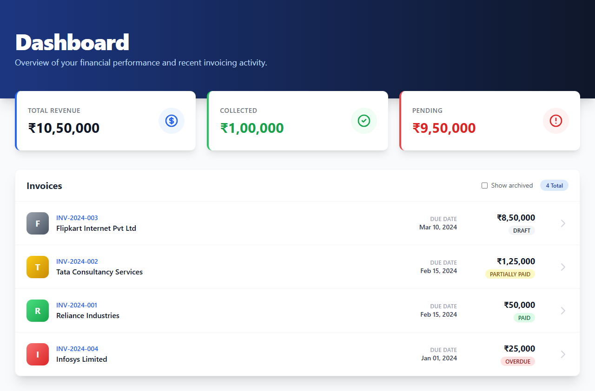
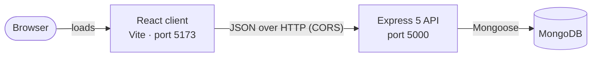
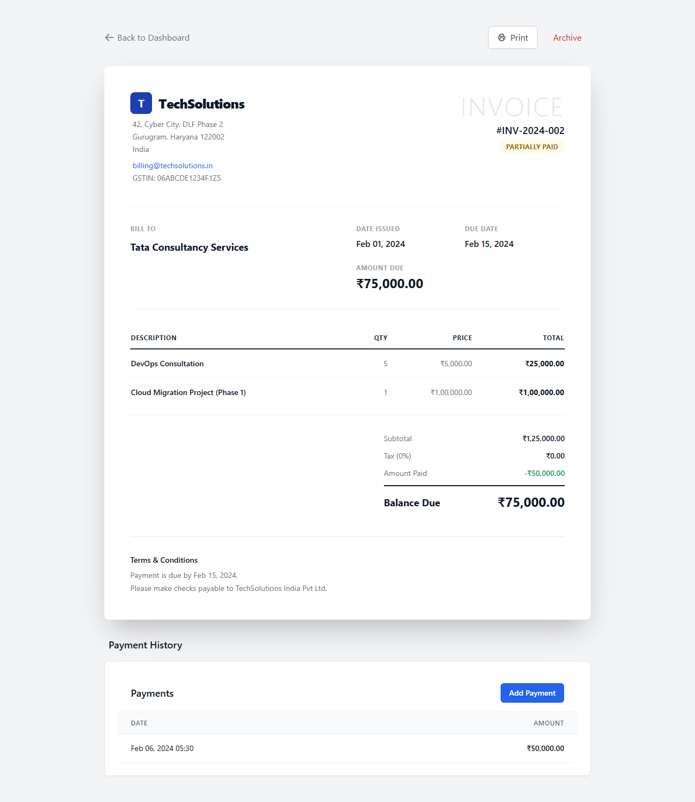
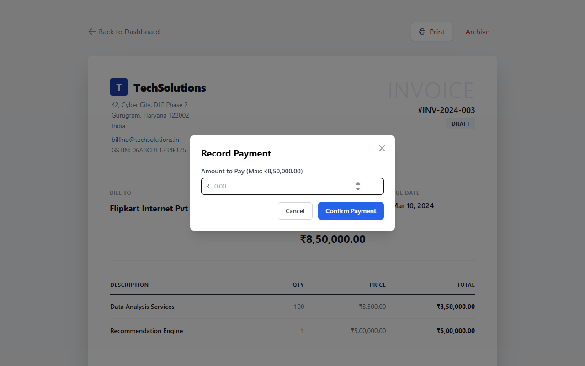

<div align="center">

# Invoice Manager

**Track what each invoice owes, record payments against it, and archive invoices that are closed out.**

A React and Express application backed by MongoDB.

[Live demo](https://invoice-manager-super.vercel.app/) · [Quick start](#quick-start) · [API reference](#api-reference) · [Deployment guide](DEPLOYMENT.md)


</div>

---

## Table of contents

- [Overview](#overview)
- [Features](#features)
- [How it works](#how-it-works)
- [Quick start](#quick-start)
- [Configuration](#configuration)
- [Usage](#usage)
- [API reference](#api-reference)
- [Business rules](#business-rules)
- [Data model](#data-model)
- [Project structure](#project-structure)
- [Scripts](#scripts)
- [Testing](#testing)
- [Deployment](#deployment)
- [Troubleshooting](#troubleshooting)
- [Known limitations](#known-limitations)
- [Roadmap](#roadmap)
- [Contributing](#contributing)

## Overview

Invoice Manager shows what each invoice owes and what has been collected. The dashboard summarises revenue, collected and pending amounts across active invoices. Each invoice has its own page with line items, totals and payment history. Payments are recorded against an invoice, which updates its balance and status, and invoices can be archived when they are no longer active.

Every payment is checked against the invoice's balance on the server, and the update runs as a single guarded write in MongoDB. Simultaneous payments cannot push an invoice past what it owes.



## Features

**Dashboard**

- Total revenue, collected and pending amounts across active invoices
- Invoice list with status badges and due dates, newest issue date first
- "Show archived" toggle; archived rows carry an `ARCHIVED` marker

**Invoice details**

- Issuer details from one configuration file, customer details from the invoice
- Issue and due dates, line items with computed totals
- Subtotal, amount paid and balance due, with payment terms that state the due date
- Print button that opens the browser's print dialog

**Payments**

- Record a payment from a dialog with inline validation and server messages
- Amounts must be positive, have at most two decimal places and not exceed the balance
- Safe under concurrency: payments that no longer fit the balance are refused
- Status moves from `DRAFT` to `PARTIALLY_PAID` to `PAID`

**Archive and restore**

- Archive or restore an invoice from its details page
- Archived invoices are excluded from dashboard totals and refuse new payments

**Operations**

- Sample data seed that refuses to overwrite existing data without `--force`
- Configuration checked at start-up, with readable messages
- Errors returned as JSON; internal details are kept out of responses
- Configurable CORS origins

## How it works



A payment request follows these steps:

1. The amount is parsed as a number with at most two decimal places.
2. The invoice is checked for archived status and for enough balance, so obvious refusals never write anything.
3. The payment record is written.
4. A single update in MongoDB adds the amount only if the balance still covers it, and computes the new balance and status inside the database.
5. If that update does not match, the payment record is removed and the request is refused.

The result is that the payment history always agrees with the invoice, even when requests overlap.



## Quick start

### Prerequisites

- **Node.js 20.19 or newer**, with npm
- **A MongoDB database**: a [MongoDB Atlas](https://www.mongodb.com/cloud/atlas) connection string, or a local `mongod`
- **Internet access** the first time you run the tests, unless you point them at a local `mongod` (see [Testing](#testing))

Tested with Node.js 22.12 and MongoDB 8.0 on Windows 11.

### 1. Clone and install

```bash
git clone https://github.com/mayankhansraj12/invoice-manager.git
cd invoice-manager
npm run setup
```

`npm run setup` installs the root, server and client dependencies.

### 2. Configure the server

```bash
cp server/.env.example server/.env
```

On Windows, use `copy server\.env.example server\.env`. Then set `MONGODB_URI` in `server/.env` to your database. The server refuses to start without it.

The client works without a configuration file. To set the API address explicitly, copy its example as well:

```bash
cp client/.env.example client/.env
```

### 3. Load sample data (optional)

```bash
npm run seed
```

This loads four sample invoices and prints `Seeded 4 sample invoices`. Running it again on a database that already has invoices is refused. Use `npm run seed -- --force` only on a database you intend to replace.

### 4. Run the application

```bash
npm run dev
```

| Service | Address                                                           |
| ------- | ----------------------------------------------------------------- |
| Client  | http://localhost:5173                                             |
| API     | http://localhost:5000 (for example, `/api/invoices` returns JSON) |

Open the client address in your browser.

## Configuration

### Server (`server/.env`)

| Variable      | Required | Default | Description                                                                       |
| ------------- | -------- | ------- | --------------------------------------------------------------------------------- |
| `MONGODB_URI` | Yes      | none    | MongoDB connection string. The server exits at start-up if it is missing.         |
| `PORT`        | No       | `5000`  | Port the API listens on. A whole number from 0 to 65535.                          |
| `CORS_ORIGIN` | No       | any     | Comma-separated browser origins allowed to call the API. Unset allows any origin. |

### Client (`client/.env`)

| Variable       | Required | Default                 | Description                                                                      |
| -------------- | -------- | ----------------------- | -------------------------------------------------------------------------------- |
| `VITE_API_URL` | No       | `http://localhost:5000` | Base URL of the API, without a trailing slash. Set it when the API is elsewhere. |

The issuer name, address, GSTIN and payee shown on invoices are set in [`client/src/config/company.js`](client/src/config/company.js).

## Usage

1. **Dashboard.** Open the client. Active invoices are listed newest first, with their totals above the list.
2. **Invoice details.** Select an invoice to open its page, with line items, totals, terms and payment history.
3. **Record a payment.** Select **Add Payment**, enter an amount and confirm. The balance, status and history update once the server saves the payment. If the server refuses it, the message appears in the dialog and the amount you entered is kept.
4. **Archive or restore.** Select **Archive** to archive an invoice, or **Restore** to bring it back. Archived invoices leave the dashboard totals and cannot take payments.
5. **Show archived.** Tick **Show archived** on the dashboard to see archived invoices, marked `ARCHIVED`.
6. **Print.** Select **Print** on an invoice page to open the browser's print dialog.



The same operations are available over HTTP. The examples assume the default port:

```bash
# Fetch an invoice by its invoice number
curl http://localhost:5000/api/invoices/INV-2024-002

# Record a payment of 1000
curl -X POST http://localhost:5000/api/invoices/INV-2024-002/payments \
  -H "Content-Type: application/json" \
  -d '{"amount": 1000}'

# Archive an invoice
curl -X POST http://localhost:5000/api/invoices/archive \
  -H "Content-Type: application/json" \
  -d '{"id": "INV-2024-004"}'
```

## API reference

Base URL: `http://localhost:5000` by default. Requests and responses use JSON.

| Method | Path                         | Body                 | Success                                         | Errors                                                                 |
| ------ | ---------------------------- | -------------------- | ----------------------------------------------- | ---------------------------------------------------------------------- |
| GET    | `/`                          | none                 | `200` health text                               | none                                                                   |
| GET    | `/api/invoices`              | none                 | `200` array of all invoices, newest issue first | none                                                                   |
| GET    | `/api/invoices/:id`          | none                 | `200` `{ invoice, lines, payments }`            | `404` invoice not found                                                |
| POST   | `/api/invoices/:id/payments` | `{ "amount": 1000 }` | `201` `{ payment, invoice }`                    | `400` invalid amount or above balance; `404` not found; `409` archived |
| POST   | `/api/invoices/archive`      | `{ "id": "…" }`      | `200` `{ message, invoice }`                    | `400` missing or non-string `id`; `404` not found                      |
| POST   | `/api/invoices/restore`      | `{ "id": "…" }`      | `200` `{ message, invoice }`                    | `400` missing or non-string `id`; `404` not found                      |

`:id` and `id` accept an invoice number such as `INV-2024-002`, or a MongoDB ObjectId. `amount` is a positive number, or a decimal string, with at most two decimal places.

### Error responses

Every error has the shape `{ "message": "..." }`.

| Status | Message                                                            | When                                                          |
| ------ | ------------------------------------------------------------------ | ------------------------------------------------------------- |
| 400    | `Amount must be a positive number with at most two decimal places` | Amount is missing, non-numeric, zero, negative or too precise |
| 400    | `Payment amount exceeds balance due`                               | Amount is larger than the balance                             |
| 400    | `Invoice ID is required` / `Invoice ID must be a string`           | Archive or restore request has a bad `id`                     |
| 400    | `Request body must be valid JSON`                                  | Body is malformed JSON                                        |
| 404    | `Invoice not found`                                                | No invoice matches the identifier                             |
| 404    | `Route not found`                                                  | Path does not exist under the API                             |
| 409    | `Invoice is archived. Restore it before recording a payment`       | Payment on an archived invoice                                |
| 500    | `Internal server error`                                            | Unexpected failure; details are logged on the server          |

### Example: invoice details

`GET /api/invoices/INV-2024-002` (abbreviated):

```json
{
  "invoice": {
    "invoiceNumber": "INV-2024-002",
    "customerName": "Tata Consultancy Services",
    "status": "PARTIALLY_PAID",
    "total": 125000,
    "amountPaid": 50000,
    "balanceDue": 75000,
    "isArchived": false
  },
  "lines": [
    { "description": "DevOps Consultation", "quantity": 5, "unitPrice": 5000, "lineTotal": 25000 },
    {
      "description": "Cloud Migration Project (Phase 1)",
      "quantity": 1,
      "unitPrice": 100000,
      "lineTotal": 100000
    }
  ],
  "payments": [{ "amount": 50000 }]
}
```

The real response also includes `_id`, `issueDate`, `dueDate` and `__v` fields.

### Example: a refused payment

```bash
curl -X POST http://localhost:5000/api/invoices/INV-2024-002/payments \
  -H "Content-Type: application/json" -d '{"amount": "1000.005"}'
```

```json
{ "message": "Amount must be a positive number with at most two decimal places" }
```

## Business rules

| Rule                | Behaviour                                                                                                     |
| ------------------- | ------------------------------------------------------------------------------------------------------------- |
| Amount              | A positive number, or a decimal string, with at most two decimal places                                       |
| Balance             | A payment cannot exceed the balance due                                                                       |
| Archived invoices   | Refuse payments with `409`. They are excluded from dashboard totals and can be restored                       |
| Concurrent payments | Applied through one guarded database update. A payment that no longer fits the balance is refused and removed |
| Status              | `DRAFT` when created, `PARTIALLY_PAID` after a partial payment, `PAID` when the balance reaches zero          |
| `OVERDUE`           | Appears only in sample data. It is not derived from the due date                                              |
| Overpayment         | Refused. There is no credit or refund model                                                                   |

## Data model

| Collection     | Key fields                                                                                                                                                  | Notes                                                                 |
| -------------- | ----------------------------------------------------------------------------------------------------------------------------------------------------------- | --------------------------------------------------------------------- |
| `invoices`     | `invoiceNumber` (unique), `customerName`, `customerAddress` (optional), `issueDate`, `dueDate`, `status`, `total`, `amountPaid`, `balanceDue`, `isArchived` | `total`, `amountPaid` and `balanceDue` are stored values              |
| `invoicelines` | `invoiceId` (indexed), `description`, `quantity` (at least 1), `unitPrice` (at least 0), `lineTotal`                                                        | `lineTotal` is derived from quantity and unit price before validation |
| `payments`     | `invoiceId` (indexed), `amount` (at least 0.01), `paymentDate`                                                                                              | One record per accepted payment                                       |

## Project structure

```
invoice-manager/
├── assets/
│   └── screenshots/             Images used in this README
├── client/                      React frontend (Vite)
│   ├── src/
│   │   ├── components/          Invoice header, line items, totals, payments, dialog, list
│   │   ├── config/              Issuer details printed on invoices
│   │   ├── pages/               Invoice details page
│   │   ├── services/            API client
│   │   ├── test/                Test setup
│   │   └── utils/               Money and date formatting
│   ├── eslint.config.js
│   └── vite.config.js           Build and test configuration
├── server/
│   ├── index.js                 Entry point: reads config, connects to MongoDB, listens
│   ├── src/
│   │   ├── app.js               Express app: middleware, routes, error handling
│   │   ├── config.js            Environment variable parsing and validation
│   │   ├── db.js                MongoDB connection
│   │   ├── middleware/          JSON 404 and error responses
│   │   ├── models/              Mongoose schemas
│   │   ├── routes/              Invoice API routes
│   │   └── services/            Payment rules and the guarded payment update
│   ├── scripts/seed.js          Sample data loader
│   ├── test/                    Server test suites
│   └── eslint.config.js
├── .gitattributes               Keeps line endings LF in the repository
├── .prettierignore              Files Prettier leaves alone
├── .prettierrc.json             Shared formatting rules
├── DEPLOYMENT.md                Hosting on Render and Vercel
└── package.json                 Root scripts that run both packages
```

## Scripts

Run these from the repository root.

| Command                | Purpose                                                                       |
| ---------------------- | ----------------------------------------------------------------------------- |
| `npm run setup`        | Install root, server and client dependencies                                  |
| `npm run dev`          | Start the API (restarts on change) and the client dev server                  |
| `npm run seed`         | Load sample invoices. Refuses when invoices exist; `-- --force` replaces them |
| `npm test`             | Run the server and client test suites                                         |
| `npm run lint`         | Lint the server and the client                                                |
| `npm run format`       | Format client, server and documentation files with Prettier                   |
| `npm run format:check` | Check formatting without changing files                                       |
| `npm run build`        | Build the client for production into `client/dist`                            |

The server also has its own start script, `npm --prefix server start`, which runs `node index.js`. Production hosts use it.

## Testing

- **Server:** Node's built-in test runner. Suites start an in-memory MongoDB, so they never touch your configured database. They cover payment rules, concurrent payments, archiving, read routes, error responses, configuration, CORS, indexes and seeding.
- **Client:** Vitest with jsdom and React Testing Library. Suites cover the payment dialog, the dashboard, the details page, the header, totals, formatting helpers and API paths.

```bash
npm test
```

The first run downloads a MongoDB binary for the in-memory database. To run offline, point the tests at a `mongod` you already have:

```bash
MONGOMS_SYSTEM_BINARY=/path/to/mongod npm test
```

On Windows PowerShell, set the variable with `$env:MONGOMS_SYSTEM_BINARY = "C:\path\to\mongod.exe"` before running `npm test`.

## Deployment

The API is deployed to Render and the client to Vercel. [DEPLOYMENT.md](DEPLOYMENT.md) has the full steps. In short:

- **API (Render):** root directory `server`, build command `npm install`, start command `node index.js`. Set `MONGODB_URI` and `CORS_ORIGIN`.
- **Client (Vercel):** root directory `client`, framework preset Vite. Set `VITE_API_URL` to the API address without a trailing slash.

Both services need Node.js 20.19 or newer.

## Troubleshooting

| Symptom                                                                             | Likely cause and fix                                                                                           |
| ----------------------------------------------------------------------------------- | -------------------------------------------------------------------------------------------------------------- |
| `MONGODB_URI is not set. Copy server/.env.example to server/.env and set it.`       | `server/.env` is missing or has no `MONGODB_URI`.                                                              |
| `PORT must be an integer between 0 and 65535`                                       | `PORT` in `server/.env` is not a valid port number.                                                            |
| `listen EADDRINUSE` on startup                                                      | Another process uses the port. Set `PORT` in `server/.env`, and set `VITE_API_URL` to the same address.        |
| `The database already has N invoice(s). Run the seed with --force to replace them.` | The seed script refused to overwrite data. Use `npm run seed -- --force` only on a database you can replace.   |
| The dashboard shows "Failed to load invoices"                                       | The API is not running, or `VITE_API_URL` points somewhere else. Check `http://localhost:5000/api/invoices`.   |
| Browser console shows a CORS error                                                  | `CORS_ORIGIN` does not match the client address exactly. Include the scheme, and leave off the trailing slash. |
| Installs or runs fail with unexpected errors                                        | Check the Node.js version (`node -v`). Node.js 20.19 or newer is required.                                     |

## Known limitations

- **No authentication or authorization.** Anyone who can reach the API can record payments and archive or restore invoices. Put the API behind an authenticating layer before exposing it.
- **No way to create invoices or line items through the API.** Data comes from the database or the seed script.
- **Totals are stored, not calculated from lines.** Changing a line item directly in the database does not update `total`, `amountPaid` or `balanceDue`.
- **`OVERDUE` is not derived.** Invoices do not become overdue when their due date passes.
- **Overpayments are refused.** There is no credit or refund model.
- **Tax is always 0%.** Invoices have no tax field.
- **No rate limiting.**
- **Dashboard totals are calculated in the browser** from the full invoice list. This is fine at this size but will not scale to large datasets.
- **Printing** uses the browser's print dialog. The print layout has not been checked on paper or PDF output.

## Roadmap

These are intentions, not commitments:

- Authentication and per-user access to invoices
- Endpoints for creating invoices and line items, with totals derived from lines
- Derived overdue status and reminders
- A credit model for overpayments, and write-offs
- Tax fields and per-invoice tax rates
- A CI workflow that runs the lint, test and build scripts on every push

## Contributing

Before opening a pull request, run the same checks the project uses:

```bash
npm test
npm run lint
npm run format:check
```

Keep changes focused. Add or update a test for each behaviour change, especially for payments and archiving.
